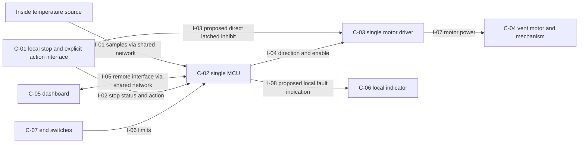

# Architecture proposal

Configuration: GH-DRAFT-01 textual proposal. No modeling-tool project or deployed design was changed. Source IDs and requirement contracts are in [01-requirements.md](01-requirements.md); unresolved decisions are in [04-trace-and-decisions.md](04-trace-and-decisions.md).

## Boundary and proposed physical structure

The shared network carries nominally 1 s temperature samples and dashboard traffic. One MCU accepts eligible temperature readings, qualifies thresholds, arbitrates requests and manages mode/fault authorization. One motor driver commands the vent mechanism. End switches report direction-specific limits. The operator acts through a local stop and an explicit automatic-enable/recovery interface.

The candidate lacks a specified local stop actuation path. The preferred review option adds a local maintained/latching inhibit path to the driver's motion-enable circuit and an MCU observation input. Its direct inhibit does not require network or MCU message processing. A local fault indicator is also proposed because a dashboard on the failed network may be unreachable. Both are additions for review, with electrical compatibility, power-loss behavior and fault detection unproved.

All arrows are directional interface proposals. The diagram does not establish redundancy, independence from common power, electrical fail-safe behavior or sufficient motor stopping performance.

## Functional decomposition and allocation

| Function | Transformation, input and output | Applicable modes | Requirements and raw sources | Proposed components |
|---|---|---|---|---|
| F-01 Qualify data availability | Temperature packets/time/identity → accepted reading or invalid/unavailable status and missing-data expiry | All; motion authorization only when enabled | RQ-06/RQ-08/DR-01; N-01/N-03 | C-02, temperature interface/shared network |
| F-02 Qualify thermal demand | Eligible readings/time → high interval, reset event, low interval and opening/closing demand | AUTO_ENABLED; restart timer policy provisional | RQ-01/RQ-02/RQ-03/DR-01; N-01 | C-02 |
| F-03 Arbitrate permission and direction | Qualified/manual/remote requests, stop, fault, limits → inhibit or one eligible directional command | All | RQ-01/RQ-03/RQ-04/RQ-05/RQ-06/RQ-08/DR-02; N-01/N-02/N-03 | C-02; C-03 final inhibit gate |
| F-04 Control and halt motion | Enable/direction/local inhibit → motor energization/removal and vent movement | OPENING, CLOSING, IDLE under orthogonal authorization flags | RQ-04/RQ-06/RQ-10/DR-02; N-02/N-03/N-04 | C-01/C-03/C-04; C-07 limits |
| F-05 Manage explicit authorization | Local stop/release, recovery action, current data/fault → latched inhibition and deliberate automatic-enable state | All | RQ-05/RQ-08/RQ-10; N-02/N-03/N-04 | C-01/C-02; C-05 only within D-07 scope |
| F-06 Indicate fault/status | Data-loss fault and mode → observable fault/status | All | RQ-07; N-03 | C-02/C-05; proposed C-06 |
| F-07 Provide remote access | Remote request/status exchange → owner-approved information/control operation | D-07 scope; subordinate to stop/fault | RQ-09/RQ-10; N-04 | C-05/C-02/shared network |

## Component responsibilities and failure dependencies

| Component | Responsibility and interfaces | Resource constraints / failure behavior to resolve |
|---|---|---|
| C-01 Local stop and action interface, proposed | Assert direct inhibit (I-03), report stop state and deliberate operator action (I-02). | Maintained/latching mechanism, wiring faults, release/reset semantics and contact behavior: D-03/D-04. Must not require network. An explicit auto-enable interface must be supplied; remote reset is not assumed. |
| C-02 One MCU, candidate | F-01/F-02/F-03/F-05/F-06/F-07; I-01/I-02/I-04/I-05/I-06/I-08. | Scheduler/clock accuracy, memory, CPU, resets, firmware, power and startup defaults unknown. Shared processor means thermal control and missing-data fault logic can fail together. Proposed output-default inhibit requires electrical validation. |
| C-03 One motor driver, candidate | Translate exclusive commands and inhibit into motor power, I-03/I-04/I-07. | Disable polarity, priority, propagation delay, braking/coasting, load/current/thermal limits and default state unknown. A shorted/stuck driver can defeat a logic-disable path; no fault tolerance is claimed. |
| C-04 Motor, vent and mechanical load | Produce movement and physical halt, I-07. | Travel time, inertia, gear behavior, holding capability, force, weather load and safe position unknown: D-08/D-09/D-11. Drive removal may permit coast or wind-driven movement. |
| C-05 Dashboard, candidate | Remote access and status, I-05. | Network failure makes availability uncertain. Scope, security, reconnection/replay and remote movement privileges await D-07. Must not own local stop enforcement. |
| C-06 Local fault indicator, proposed | Show fault through I-08 when dashboard network fails. | Type, power, visibility, latching and indication deadline await D-06. Common power can remove indication. |
| C-07 End switches, candidate | Signal opening/closing limits through I-06. | Switch count/location, polarity, wiring diagnostics, bounce, contradictory limits and direct driver interruption unknown. They do not establish mid-travel position or stop distance. |

Dependencies to review: shared supply/ground, reset and clock; one MCU and common firmware/configuration; one driver; network used for both sensing and remote access; shared enclosure/environment; stop wiring and maintenance; operator availability. A direct stop path reduces network dependence but retains driver, power and mechanical common causes. No failure probability, availability or independence claim is supportable without D-12 evidence.

## Mode and transition contract

Use orthogonal authorization flags and motion state rather than one mode that loses simultaneous stop/fault information. Suggested flags are `auto_authorized`, `local_stop_latched` and `data_fault_latched`; data eligibility and end limits are additional guards. Motion state is IDLE/OPENING/CLOSING. These are proposed logical names, not code.

| Event / condition | Proposed state/output response | Basis and unresolved decision |
|---|---|---|
| Startup/reset | Driver commanded inhibited; `auto_authorized=false`; collect qualified data before any deliberate enable. | Conservative proposal, D-03/D-11; N-02/N-03 do not specify power-cycle recovery. |
| Local stop asserted in any state | Direct local inhibit asserts; latch stop, clear auto authorization, cancel pending demands, request stop; preserve any fault latch. | RQ-04/RQ-05/RQ-10; N-02/N-04; D-04 sets physical outcome. |
| Local stop released | Do not automatically clear authorization inhibition or restart. | RQ-05; N-02. Whether physical latch release and explicit enable can be a single action: D-03/D-04. |
| Missing-data expiry | Set data fault latch; clear auto authorization; inhibit/stop; show fault. Stop has priority over demand qualification at the same processing instant. | RQ-06/RQ-07/RQ-08/DR-02; N-03; event origin and latency D-05/D-10. |
| Data returns | Update current data eligibility; retain fault latch and disabled automatic authorization. | RQ-08; N-03. No motion just because high/low readings return. |
| Explicit recovery/enable action | Proposed guard: no active local stop, qualified fresh data and resolved active fault. Acknowledge fault and enable only under D-03's approved action protocol. Reset thermal timers before new qualification, proposed. | RQ-05/RQ-08; N-02/N-03; timer reset on recovery is a design choice, D-01/D-03. |
| High/low qualification completes with permission | Submit one directional demand through arbitration. Motion continuation/cancellation/reversal policy remains undefined. | RQ-01/RQ-03/DR-02; N-01; D-08 must decide persistence of a qualified demand during travel. |
| Direction-specific end limit | Proposed: inhibit further drive in that direction. Contradictory limits or failed switch behavior must be specified before implementation. | Candidate end switches; D-08/D-11; no added source obligation is asserted. |
| Concurrent stop, data loss and remote/thermal demand | Retain both inhibition reasons; no effective directional drive; clearing one reason leaves the other effective. | RQ-04/RQ-05/RQ-06/RQ-08/RQ-10/DR-02; N-02/N-03/N-04. |

## Interface contracts

| Interface | Source → target; exchanged item and units/format | Timing and validity responsibility | Error handling / missing agreement |
|---|---|---|---|
| I-01 | Inside source via shared network → C-02; temperature in deg C, source identity, proposed sequence/timestamp/quality fields | Nominal 1 s is input fact. Maximum gap/jitter/latency and field schema unspecified. Sensor owns measurement; MCU owns acceptance/availability. | D-01/D-05 set stale/invalid rules and clock relationship. Duplicate/reordered data must not renew freshness under DR-01. Lost network can make temperature unavailable. |
| I-02 | C-01 → C-02; asserted stop state and explicit operator action, digital semantics TBD | Local electrical path; no network dependency. MCU owns latches/guards; event debounce/detection latency TBD. | D-03/D-04 set active polarity, failed wiring response and distinction between stop release, fault acknowledgment and enable. Debounce must not silently postpone stop. |
| I-03 | C-01 → C-03; proposed hardwired maintained/latching motion inhibit | Stop circuit and driver own final disable; polarity, edge reference and delay TBD. | D-04/D-11 confirm direct inhibit overrides I-04. No supported claim for stuck-driver failure. Reset cannot bypass an active stop. |
| I-04 | C-02 → C-03; OPEN/CLOSE/ENABLE or equivalent digital contract | Exclusive commands; inhibit wins. MCU owns command consistency; driver owns interpretation and electrical response. | D-04/D-08 define default inhibit, reversal sequence/deadtime and fault behavior. Interface delay budget unknown. |
| I-05 | C-05 ↔ C-02 through shared network; status and approved remote operations | Rates, delivery semantics, freshness, authentication and permissions TBD under D-07. | Network failure cannot disable I-03. Reject stale/queued movement commands after reconnection under a proposed D-07 protocol. Local stop reset by remote command is unresolved, not permitted by this draft. |
| I-06 | C-07 → C-02; direction-specific reached-limit digital indications | Switch and MCU own electrical/read/debounce contract; latency TBD. | D-08/D-11 address absent/stuck/contradictory switches; travel timeout value requires measured travel evidence. |
| I-07 | C-03 → C-04; motor electrical power, polarity/current/voltage TBD | Driver/mechanical owner supplies load, inertia, response and holding data. | Disable may brake or coast; actual physical stop/holding behavior must be measured across D-09 envelope. |
| I-08 | C-02 → proposed C-06, and status via I-05; missing-data fault/mode indication | Indicator availability, timing, content and persistence await D-06/D-10. | Local indicator avoids network transport dependence; supply loss remains common cause. Fault reset display behavior follows D-03. |

## Timing, resources and trade records

Proposed data-loss origin is controller monotonic receipt time of the last accepted fresh reading. Eligibility may also need sensor acquisition age; unsynchronized sensor time cannot be subtracted without an agreed clock mapping. At the 5 s expiry, a missing-data event must take precedence. Whether invalid packets count as missing and whether sensor acquisition time instead governs expiry remain D-05 decisions. A 1 s nominal period yields no proven worst-case sampling or freshness margin.

| Path / budget | Contributions requiring evidence | Supported value / gap |
|---|---|---|
| Physical threshold crossing → eligible reading | Sensor accuracy/response + acquisition gap/jitter + network delay + validation/scheduling | All maximums unknown. Under a sample-based D-01 contract, 30/60 s start from the defined eligible sample; these intervals do not establish physical crossing-to-motion latency. |
| Eligible thermal interval → command → vent at limit | 30 s opening or 60 s closing qualification + scheduler + arbitration + driver response + travel | Qualification durations from N-01. All other terms and reaction tolerance unknown. |
| Local stop event → physical arrest | Contact/input response + direct inhibit circuit/driver delay + mechanical deceleration/coast | Sum unknown. Proposed I-03 excludes network and MCU scheduler from direct actuation; 50 ms is unsupported. Event origin and residual movement require D-04. |
| Last eligible datum → missing-data physical stop | Defined 5 s absence interval + expiry evaluation delay + arbitration/output delay + driver delay + mechanical stop | 5 s from N-03; remaining terms and deadline interpretation unresolved D-05/D-10. Cannot claim physical halt at exactly 5 s. |
| Missing-data expiry → observable fault | Detection + display update + display response; network transport if remote display | Deadline unknown; local proposed indicator removes network transport term. |

No CPU, memory, electrical current, thermal or communication budget can be closed from the inputs. Owners must measure worst-case paths and allocate limits/margins once justified; no numerical margins are invented.

| Decision record | Alternatives and review recommendation | Evidence, consequence and revisit trigger |
|---|---|---|
| AD-01 Local stop allocation | (A) network/dashboard stop; (B) local MCU input commanding disable; (C) direct local maintained/latching driver inhibit plus MCU status. Recommend C for review. | A conflicts with N-04. B removes network from the button but remains MCU/scheduling dependent. C best supports N-02/N-04 with the single-MCU candidate; adds wiring/latch integration, retains common driver/power/mechanics. No electrical tests exist. Revisit on D-04/D-11 or driver incompatibility. |
| AD-02 Data validity and time | Receipt-only presence; sensor age only; combined eligibility using identity/sequence and age with a controller monotonic timeout. Recommend combined eligibility for review. | N-01/N-03 plus shared network motivate stale/replay handling. Additional metadata/clock contract may be needed. No age/gap bound selected. Revisit on D-01/D-05 and actual sensor protocol. |
| AD-03 Fault display | Dashboard only; local indication plus dashboard status. Recommend local indication plus dashboard. | N-03 demands visible fault; N-04/shared network exposes dashboard availability risk. Adds proposed C-06 and supply/visibility questions. Revisit on D-06. |
| AD-04 Recovery protocol | Auto-restart on packet return; deliberate guarded recovery/automatic-enable action. Recommend deliberate guarded action. | Auto-restart conflicts with N-03; deliberate auto resumption also supports N-02. Exact number/location of actions unapproved D-03/D-07. Revisit on operator validation. |

Architecture closure requires agreed interval/validity semantics, interface electrical data, motion policy, environment and measured timing. This proposal supports review, not a claim that the candidate design is already adequate.
