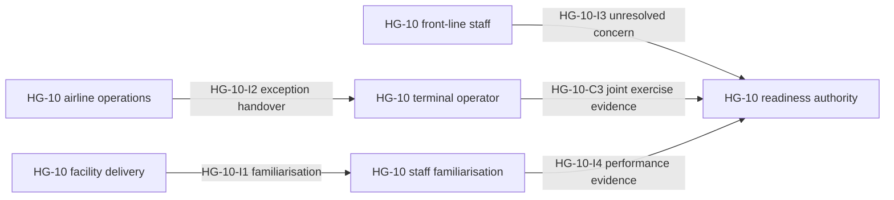

# Heathrow Terminal 5: opening a service is an integration test

**HG-10 · 2008 · transport · transition failure**

Operational readiness depends on people, logistics, software, facilities, and shared authority working together under representative conditions.

All `HG-` identifiers are new teaching identifiers. Historical facts below
are attributed to sources; the boundary, decisions, artifact, questions, and
transfer exercise are newly authored. No local historical simulation was performed.

## Source-grounded facts

- **HG-10-F1:** The committee found that building delays compressed staff familiarisation and questioned whether training and trials prepared staff for opening conditions. [HG-10-S1](https://publications.parliament.uk/pa/cm200708/cmselect/cmtran/543/54304.htm); Paragraphs 8–14.
- **HG-10-F2:** It examined communication failures between operator and airline and the treatment of concerns raised by staff. [HG-10-S2](https://publications.parliament.uk/pa/cm200708/cmselect/cmtran/543/54305.htm); Paragraphs 15–19.

## Retrospective systems analysis

**Boundary.** Passenger journey, staff access, baggage flow, facilities, airline processes, terminal operator, and disruption recovery form the service boundary.

**Interfaces to examine**

- Facilities handover → staff training: incomplete spaces can invalidate planned familiarisation.
- Airline → terminal operator: baggage and passenger exceptions require shared ownership and rapid coordination.

**Decision.** What evidence supports opening when subsystem completion reports are favorable?

- Aggregate installation and training-attendance percentages.
- Exercise end-to-end journeys and exceptions with representative staff, loads, and facilities.

**Teaching recommendation.** Use an integrated readiness decision with explicit exception handling and a staged transition option.

**Uncertainty.** The historical report does not prove which exact staging plan would have prevented the disruption.

## HG-10-A1: Operational readiness slice

This proposed artifact is a compact starting point for review. Its evidence
requests are unexecuted; its rows are not recovered project requirements.

| Item | Proposed disposition | Evidence to seek |
| --- | --- | --- |
| Staff arrival | Demonstrate access, orientation, and workstation readiness | Representative shift exercise |
| Bag exception | Follow a delayed or misrouted bag across organizational boundaries | Timed exception recovery and accountable owner |
| Opening disruption | Agree service reduction and recovery authority | Joint rehearsal and decision log |

## Connected review exercise

- [Connected review task](review-task.md) — A bounded review using multiple linked artifacts.
- [Source fact register](source-facts.csv) — Attributed facts and exact report locators.
- [Editable interface register](interfaces.csv) — New reconstruction with fact-level basis links.
- [Claim and evidence register](claim-evidence.csv) — Supported observations separated from unexecuted checks.
- [Synthetic change request](change.json) — A new transfer problem with affected teaching IDs.
- [Editable relation view](relations.mmd) — Information dependencies with teaching IDs.
- [Public review guide](review-guide.md) — Reasoning criteria and limitations for formative feedback.

New teaching relation view; arrows show information dependencies.

## Practice engineering judgment

1. How can all component owners report green while the service remains unready?
2. What does attendance prove about training, and what does it not prove?
3. Write a readiness recommendation that makes a phased opening decision reviewable.

**Reasoning signals for a formative review**

- Models handovers and exceptions, not only nominal flow.
- Distinguishes activity completion from demonstrated performance.
- Includes front-line knowledge and joint operational authority.

**Transfer exercise.** Synthetic: a hospital moves into a new building while its scheduling software also changes. Select three cross-team acceptance scenarios.

**Limits.** The proposed readiness slice is new teaching material, not a recovered airport acceptance plan.

## Sources and access

- **HG-10-S1: [House of Commons Transport Committee: The opening of Heathrow Terminal 5](https://publications.parliament.uk/pa/cm200708/cmselect/cmtran/543/54304.htm)**
  — 2008-11-03; original investigation.
  Locator: Chapter 2, paragraphs 8–14.
  Relevant content inspected 2026-11-13. Committee conclusions and witness accounts are distinguishable; trial participation alone does not establish trial representativeness.
- **HG-10-S2: [The opening of Heathrow Terminal 5: communication and lessons](https://publications.parliament.uk/pa/cm200708/cmselect/cmtran/543/54305.htm)**
  — 2008-11-03; original investigation.
  Locator: Chapter 3, paragraphs 15–19.
  Relevant content inspected 2026-11-13. The committee explicitly avoided certainty that better cooperation would have prevented every problem.

[Structured case record](analysis.json) · [Gallery](../README.md) · [Source register](../../../docs/sources-historical.md)
