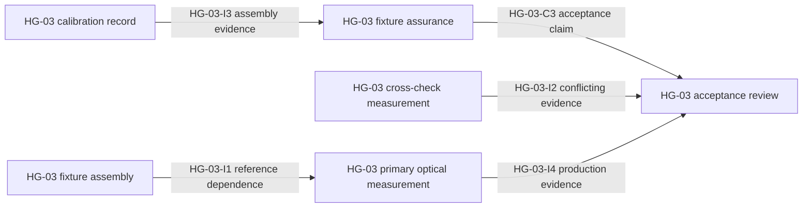

# Hubble: verify the verifier

**HG-03 · 1990 · space · failure and repair opportunity**

Independence concerns the assumptions and physical references behind a test, not just the number of test results.

All `HG-` identifiers are new teaching identifiers. Historical facts below
are attributed to sources; the boundary, decisions, artifact, questions, and
transfer exercise are newly authored. No local historical simulation was performed.

## Source-grounded facts

- **HG-03-F1:** The board traced the primary-mirror figure error to an incorrectly assembled reflective null corrector used in manufacture and verification. [HG-03-S1](https://ntrs.nasa.gov/api/citations/19910003124/downloads/19910003124.pdf); Executive summary.
- **HG-03-F2:** Other optical tests indicated an error, but their indications were discounted; the main corrector had not received an independent dimensional verification after assembly. [HG-03-S1](https://ntrs.nasa.gov/api/citations/19910003124/downloads/19910003124.pdf); Executive summary; null-corrector investigation.

## Retrospective systems analysis

**Boundary.** Mirror, metrology fixture, fixture assembly, test interpretation, supplier oversight, and acceptance authority belong inside the optical acceptance boundary.

**Interfaces to examine**

- Fixture geometry → optical result: an incorrect reference can make repeatable measurements misleading.
- Anomalous test → acceptance decision: contradictory evidence needs a recorded resolution.

**Decision.** Should agreement with the production reference close an optical acceptance claim?

- Accept repeated agreement with the same reference.
- Require an independent check of the reference and disposition conflicting measurements.

**Teaching recommendation.** Choose evidence with a different failure mechanism and preserve unexplained disagreement.

**Uncertainty.** Independent measurement has its own uncertainty; two results are not a vote unless their error sources are understood.

## HG-03-A1: Metrology evidence independence map

This proposed artifact is a compact starting point for review. Its evidence
requests are unexecuted; its rows are not recovered project requirements.

| Item | Proposed disposition | Evidence to seek |
| --- | --- | --- |
| Production measurement | Record reference geometry and calibration chain | As-assembled dimensions and uncertainty budget |
| Cross-check | Use a different reference or physical principle | Analysis of shared assumptions |
| Conflict | Keep acceptance claim open until resolved | Repeatable explanation of discrepant readings |

## Connected review exercise

- [Connected review task](review-task.md) — A bounded review using multiple linked artifacts.
- [Source fact register](source-facts.csv) — Attributed facts and exact report locators.
- [Editable interface register](interfaces.csv) — New reconstruction with fact-level basis links.
- [Claim and evidence register](claim-evidence.csv) — Supported observations separated from unexecuted checks.
- [Synthetic change request](change.json) — A new transfer problem with affected teaching IDs.
- [Editable relation view](relations.mmd) — Information dependencies with teaching IDs.
- [Public review guide](review-guide.md) — Reasoning criteria and limitations for formative feedback.

New teaching relation view; arrows show information dependencies.

## Practice engineering judgment

1. Which dependencies make apparently separate tests correlated?
2. How would you distinguish a bad test from a bad article?
3. Write an acceptance statement that admits unresolved conflicting evidence.

**Reasoning signals for a formative review**

- Maps shared fixtures, calibration, software, and assumptions.
- Proposes a discriminating check before discarding an inconvenient result.
- Keeps measurement repeatability separate from accuracy.

**Transfer exercise.** Synthetic: two inspection systems use the same generated geometry file. Draft a third check that can detect an error in that file.

**Limits.** This case concerns the 1990 investigation. It does not claim that the proposed artifact was used by the project or that a new optical analysis was executed.

## Sources and access

- **HG-03-S1: [The Hubble Space Telescope Optical Systems Failure Report, NASA-TM-103443](https://ntrs.nasa.gov/api/citations/19910003124/downloads/19910003124.pdf)**
  — 1990-11; original investigation.
  Locator: Executive summary; null-corrector investigation.
  Relevant content inspected 2026-11-13. Relevant sections inspected; this is not a reconstruction of every event or finding.

[Structured case record](analysis.json) · [Gallery](../README.md) · [Source register](../../../docs/sources-historical.md)
