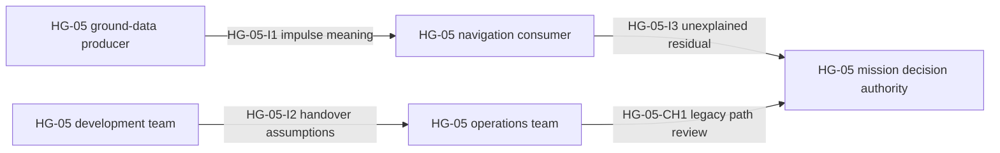

# Mars Climate Orbiter: own the meaning of an interface

**HG-05 · 1999 · space · failure**

An interface contract includes semantic meaning, producers, consumers, checks, and operational handover.

All `HG-` identifiers are new teaching identifiers. Historical facts below
are attributed to sources; the boundary, decisions, artifact, questions, and
transfer exercise are newly authored. No local historical simulation was performed.

## Source-grounded facts

- **HG-05-F1:** The board identified English-unit impulse data in a ground-software output where the interface specified metric units; navigation processing assumed the specified units. [HG-05-S1](https://discovery.larc.nasa.gov/pdf_files/MCO_report_2.pdf); Executive summary; section 4.
- **HG-05-F2:** Its contributing causes also included transition to operations, communication, staffing, training, and ground-software verification weaknesses. [HG-05-S1](https://discovery.larc.nasa.gov/pdf_files/MCO_report_2.pdf); Executive summary; section 5.

## Retrospective systems analysis

**Boundary.** Spacecraft events, ground data generation, navigation ingestion, trajectory review, and development-to-operations handover belong to one mission information flow.

**Interfaces to examine**

- Producer → consumer: numerical values require units, reference frame, sign convention, timing, and version.
- Predicted trajectory → operations team: persistent residuals need owned investigation and escalation.

**Decision.** What closes an interface verification claim?

- Each team reports its own software test success.
- Both teams demonstrate shared semantics with an independently checked end-to-end sample.

**Teaching recommendation.** Require a semantic contract and operational anomaly ownership together.

**Uncertainty.** A unit-tagged file alone does not verify the physical quantity, calibration, or trajectory model.

## HG-05-A1: Interface acceptance contract

This proposed artifact is a compact starting point for review. Its evidence
requests are unexecuted; its rows are not recovered project requirements.

| Item | Proposed disposition | Evidence to seek |
| --- | --- | --- |
| Impulse field | Declare quantity, units, frame, sign, and event interval | Hand-checkable input/output sample agreed by both teams |
| Consumer check | Reject invalid or unrecognized semantics | Negative tests and observed error handling |
| Operational discrepancy | Assign residual investigation and escalation owner | Recorded threshold rationale and disposition history |

## Connected review exercise

- [Connected review task](review-task.md) — A bounded review using multiple linked artifacts.
- [Source fact register](source-facts.csv) — Attributed facts and exact report locators.
- [Editable interface register](interfaces.csv) — New reconstruction with fact-level basis links.
- [Claim and evidence register](claim-evidence.csv) — Supported observations separated from unexecuted checks.
- [Synthetic change request](change.json) — A new transfer problem with affected teaching IDs.
- [Editable relation view](relations.mmd) — Information dependencies with teaching IDs.
- [Public review guide](review-guide.md) — Reasoning criteria and limitations for formative feedback.

New teaching relation view; arrows show information dependencies.

## Practice engineering judgment

1. Why is adding unit conversion code an incomplete corrective action?
2. Who owns acceptance when producer and consumer are different organizations?
3. State what a persistent unexplained residual means without declaring a cause prematurely.

**Reasoning signals for a formative review**

- Separates schema conformance from physical meaning.
- Includes end-to-end evidence and handover responsibility.
- Keeps investigation open until discrepancies are explained.

**Transfer exercise.** Synthetic: a supplier delivers actuator impulse data to a fleet model. Draft a sample contract including one rejection case.

**Limits.** No reconstructed orbit or numerical failure simulation is provided. The original report describes multiple contributing conditions.

## Sources and access

- **HG-05-S1: [Mars Climate Orbiter Mishap Investigation Board Phase I Report](https://discovery.larc.nasa.gov/pdf_files/MCO_report_2.pdf)**
  — 1999-11-10; original investigation.
  Locator: Executive summary pp. 6–8; sections 4–5, pp. 16–24.
  Relevant content inspected 2026-11-13. Relevant sections inspected; this is not a reconstruction of every event or finding.

[Structured case record](analysis.json) · [Gallery](../README.md) · [Source register](../../../docs/sources-historical.md)
