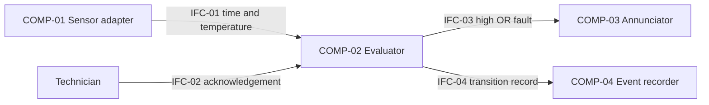

# Architecture and allocation

The logical design separates sensing, evaluation, local annunciation, and events.
`reference_model.py` emulates evaluation/event behavior and returns output flags;
it does not implement the sensor or sound/light actuator.

| Function | Requirements | Allocation | Responsibility |
| --- | --- | --- | --- |
| FUN-01 Qualify temperature interval | REQ-01 | COMP-02 | Reset pending timer on invalid/low input; latch after interval |
| FUN-02 Diagnose input availability | REQ-02 | COMP-01, COMP-02 | Invalid input detection and valid recovery |
| FUN-03 Retain/acknowledge warning | REQ-03 | COMP-02, COMP-03 | Preserve high latch and expose state |
| FUN-04 Record state changes | REQ-04 | COMP-02, COMP-04 | Once per changed state pair |

IFC-01: `(time_ms, temperature_c)` on contiguous 100 ms ticks. None, NaN, infinity,
booleans, and nonnumeric values are invalid temperatures. The model rejects gaps,
duplicate/out-of-order ticks, noninteger times, and nonboolean acknowledgement.
IFC-02: acknowledgement at current tick. IFC-03: separate high/fault and their OR
as local alarm. IFC-04: ordered `time_ms`, `high`, `sensor_fault` records in volatile memory.

AD-01: high latches, fault automatically clears on valid recovery to distinguish
an excursion requiring acknowledgement from a current diagnostic condition.
AD-02: discrete ticks make teaching checks reproducible; continuous timing and
missing-tick handling remain open. AD-03: transitions are logged once; persistence is open.

HAZ-01: unnoticed excursion, CTL-01: warning plus operator action. HAZ-02:
misleading healthy indication during sensor failure, CTL-02: invalid-input detection.
Tests check modeled controls; noisy-lab effectiveness and reagent protection are
unvalidated. Shared power is a common dependency, not redundancy.
